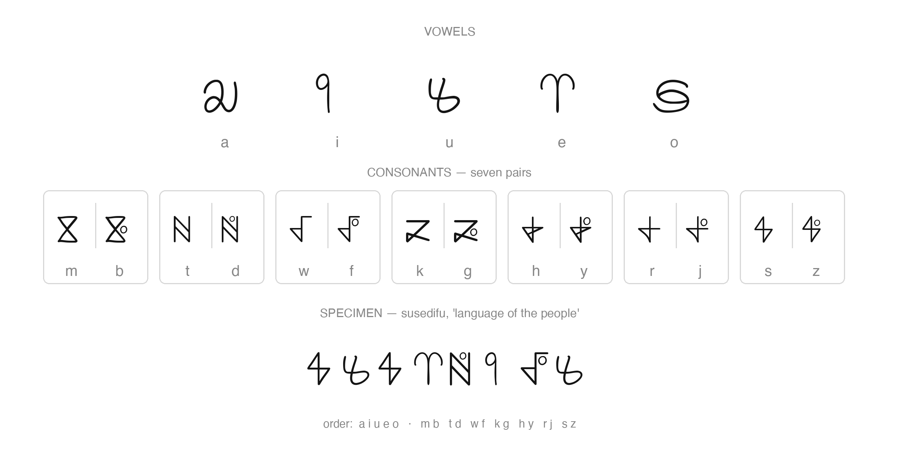

# susedifu

susedifu is a constructed language, the 'language of the people' (suse 'speech' + difu 'person'), with a custom script font.

## Language highlights

- **Agglutinative morphology** — new words derive from basic roots by compounding:
  - `hosi` (air) + `we` → `hosiwe` (wind)
  - `suse` (speech) + `difu` (person) → `susedifu` (the language's own name)
  - `di-` marks person: `dikabu` (creator / god), `didabu` (worker), `dijohua` (Chinese person)
- **A fictional world** — the vocabulary carries the Difu people's world setting: magic (woza), the magic-storing organ (dukawoza), the king (disamu) and his scepter (yikasamu), the capital Mahasamu (mahasamu), and more

## Repository layout

| Path | Description |
| --- | --- |
| `lexicon.toml` | The lexicon — 68 entries (64 base + 4 bound morphemes), grouped by semantic field; the single source of truth for words and etymology |
| `grammar/` | Grammar docs: phonology, morphology, syntax, and a regression corpus of example sentences |
| `swadesh-coverage.md` | Swadesh 207-item coverage map with empty slots reserved for manual word-filling |
| `alphabet.md` | The alphabet — owner-confirmed letter order, letterform chart, and the script's open points |
| `fonts/` | The custom script font (TTF + SVG) |

## License

- Language data and documentation: [CC BY 4.0](https://creativecommons.org/licenses/by/4.0/) — susedifu © 2026 asumi39 (`LICENSE`)
- The Susedifu font: [SIL Open Font License 1.1](https://openfontlicense.org/) with Reserved Font Name "Susedifu" (`LICENSE-FONT`)
