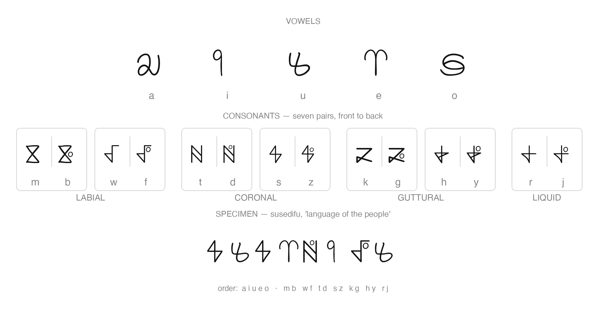

# Alphabet

> Letterforms come from the Susedifu font (`fonts/susedifu.ttf`); Latin letters are the romanization used throughout the repository, and the mapping is one-to-one.
> Claim tags: **confirmed** (owner decision) / **(attested)** = read directly from the font or the lexicon / **open** = undecided — the owner decides.

## Letter order (confirmed, 2026-11-08)

- Vowels: **a i u e o**
- Consonants, seven pairs arranged by place of articulation, front to back:
  - Labial: **m b · w f**
  - Coronal: **t d · s z**
  - Guttural: **k g · h y**
  - Sonorant: **r j**

Within each place group, the pair with more closure comes first (m b → w f, t d → s z, k g → h y). The full order: `a i u e o m b w f t d s z k g h y r j` — 19 letters.

## Letterform chart

## Attested facts

- One-to-one mapping: each Latin letter has exactly one letterform; the font has no uppercase.
- Within each consonant pair the two letterforms share a base shape — the second member adds a small circle (b = m + ◦, d = t + ◦, and likewise in all seven pairs). Whether the diacritic carries phonological meaning: open.
- All 19 letters occur in `lexicon.toml`; j is restricted to the johua family (see phonology.md).
- Punctuation glyphs in the font: space, comma `,`, period `.`, slash `/`, question mark `?`.
- The Latin letters c l n p q v have no glyphs — they correspond to sounds absent from the phoneme inventory.
- The font maps **x** in addition to the alphabet's 19 letters; x is not part of the confirmed alphabet. The design source (`fonts/susedifu.svg`) also holds a **p** layer that was never exported to the TTF.
- Repository documents are written in Latin letters; the font renders them as the custom letterforms.

## Open points

- Letter names — names are words, and words enter the language only from the owner (see AGENTS.md).
- Writing direction and text layout.
- Whether the consonant pairing carries phonological meaning (for instance t–d, k–g, s–z differ in voicing; m–b are both labial) — the pairing itself is owner-given; no rule is claimed.
- The extra glyphs x (mapped in the TTF) and p (design layer only) — keep or drop.

## Files

- `fonts/susedifu.ttf` — the compiled font: 20 letter glyphs (the alphabet's 19 + x) and 5 punctuation characters
- `fonts/susedifu.svg` — the Inkscape design source: one layer per glyph, with metric guides (ascent, cap height, x-height, baseline, descent)
